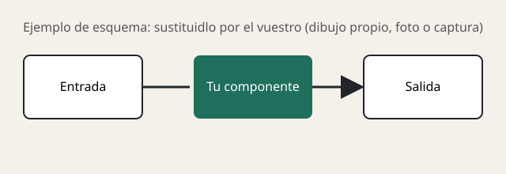

# Puzzle UT2 · Pieza NN: Nombre de la pieza

**Grupo:** Nombre Apellido (@usuario) · Nombre Apellido (@usuario)

> Máximo 2 folios por las dos caras (unas 1.600–2.000 palabras) y al menos 3 imágenes en `img/`.

## 1. Qué es y qué función cumple en el sistema
La CPU es el procesador principal del ordenador, el «cerebro» del equipo. Se encarga de interpretar y ejecutar las instrucciones de los programas y del sistema operativo realizando cálculos y operaciones lógicas. Además, coordina el resto de componentes (RAM, almacenamiento, gráfica) para que el sistema funcione en equipo.

## 2. Cómo funciona por dentro
Las CPU actuales usan la arquitectura Von Neumann, guardando datos e instrucciones en la misma memoria. Sus partes principales son:

ALU (Unidad Aritméticológica): Realiza las operaciones matemáticas y lógicas.

Unidad de Control (UC): Lee las instrucciones, las interpreta y coordina las órdenes.

Registros: Memorias internas ultra rápidas para almacenar datos al instante.

<!-- Guardad vuestras imágenes en img/ y cambiad el nombre del archivo en la línea de arriba. -->

## 3. Características, unidades y cómo se miden

| Característica | Unidad | Valores típicos hoy | Qué significa |
|---|---|---|---|

## 4. Tipos, evolución y estándares actuales

## 5. Un modelo real: ficha técnica interpretada

**Modelo:** Marca Modelo (enlace a la ficha del fabricante)

| Dato de la ficha | Qué significa | ¿Es bueno? ¿Para qué uso? |
|---|---|---|

<!-- Aquí va la foto o captura del modelo:  -->

## 6. Averías típicas y errores al elegirla o instalarla

## 7. Fuentes

1.
2.
3.

## Uso de IA

Qué preguntamos a Jarvis u otra IA y cómo comprobamos sus respuestas.
